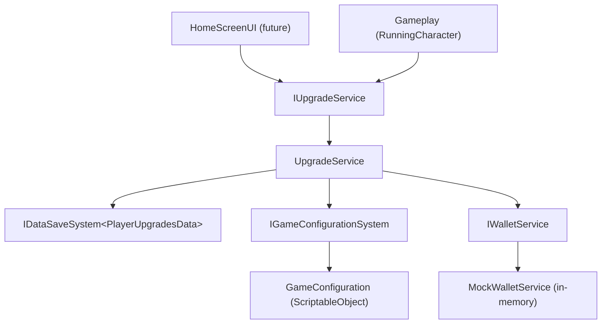

# Architecture Spine — Player Upgrades

## Design Paradigm

Service-oriented, DI-injected singletons fronted by interfaces, resolved through VContainer. Three collaborator services (persistence, configuration, wallet) feed one stateful domain service (`UpgradeService`) that owns live progression state. Async is UniTask; fallible operations return `IResult<T>`.

Namespaces:

| Concern | Namespace |
| --- | --- |
| Upgrade domain service, enum, result | `MiraculousSurfers.Gameplay.Upgrades` |
| Game configuration (interface + SO impl) | `MiraculousSurfers.Configuration` |
| Wallet / currency | `MiraculousSurfers.Economy` |
| Persisted data + save system (existing) | `MiraculousSurfers.Data` |

## Inherited Invariants

From `spec-save-system` (binding, read-only):

| Inherited | From | Binds here |
| --- | --- | --- |
| Stateless persistence (S1) | spec-save-system | Save system holds no live state → a consumer must own the live instance (AD-1) |
| `IResult<T>` non-throwing outcomes | spec-save-system | Fallible ops return `Core.Result`, never throw (AD-5) |
| Newtonsoft serialization | spec-save-system | `PlayerUpgradesData` stays Newtonsoft-serializable |
| Key-suffix versioning, no migration | spec-save-system | Changing `PlayerUpgradesData`'s shape abandons prior saves by design |
| VContainer DI | spec-save-system | Services register in a `LifetimeScope` (AD-8) |
| CLAUDE.md conventions | project | No comments, `var`, underscore privates, UniTask not coroutines, code under `Assets/MiraculousSurfers/` |

## Invariants & Rules

### AD-1 — Single stateful owner of upgrade state [ADOPTED]
- **Binds:** all upgrade state
- **Prevents:** two holders of divergent in-memory upgrade copies
- **Rule:** `UpgradeService` is the only object that holds live `PlayerUpgradesData`. Everyone else (gameplay, UI) reads through `IUpgradeService`; no one else caches the save data.

### AD-2 — Persisted state is an integer index per param
- **Binds:** `PlayerUpgradesData`, CAP-8
- **Prevents:** a second source of truth for a param's multiplier; storing derived values
- **Rule:** `PlayerUpgradesData` stores four `int` indices (one per `UpgradeParam`), default `0`. The gameplay multiplier is **derived** via `IGameConfigurationSystem.Value(param, index)`, never stored. On load, each index is **clamped to `[0, MaxIndex(param)]`** — an out-of-range saved index (config ladder shrank, or bad data) clamps to max and never indexes the config out of range or throws. (Supersedes the earlier float-value storage; requires revising the shipped `PlayerUpgradesData`/`PlayerUpgradesSaveSystem` and save-spec CAP-8 — see Deferred.)

### AD-3 — Tuning & pricing come from the game-configuration system
- **Binds:** all step/price lookups
- **Prevents:** hardcoded steps/prices; an upgrade-only provider that the real config later duplicates
- **Rule:** steps and prices are read only through `IGameConfigurationSystem` (index-addressed: `MaxIndex(param)`, `Value(param,index)`, `Price(param,index)`, `HasNext(param,index)`). Backed now by `LocalGameConfigurationSystem` reading a `GameConfiguration` ScriptableObject. `index 0` = base (value e.g. `1`, no price); upgrading `i → i+1` costs `Price(param, i+1)`; max-level = `HasNext == false` (`index == MaxIndex`).

### AD-4 — `IUpgradeService` is the one public contract
- **Binds:** gameplay reads, future HomeScreenUI
- **Prevents:** divergent param addressing; UI and gameplay coupling to internals
- **Rule:** both UI and gameplay bind to `IUpgradeService` keyed by the `UpgradeParam` enum `{ LaunchPower, Speed, SteeringResponsiveness, CollectibleValue }`: raw queries `float GetValue(param)`, `int GetNextCost(param)`, `bool CanUpgrade(param)`, plus `int GetIndex(param)` / `int GetMaxIndex(param)` for a UI `currentUpgrade/MaxUpgrades` progress bar; command `UniTask<IResult<UpgradePurchase>> TryUpgrade(param)`; `event Action<UpgradeParam> Changed`. Gameplay reads multipliers via `GetValue`, not off `PlayerUpgradesData`. `GetNextCost` returns `0` when `HasNext` is false (maxed) — callers gate price display on `CanUpgrade`/`HasNext`. `Changed` fires whenever the in-memory index actually changes (`Applied=true`), independent of `Persisted`, so UI refreshes even if the save failed.

### AD-5 — Fallible ops reuse `Core.Result`; expected outcomes are `Ok`
- **Binds:** `TryUpgrade` and any future fallible upgrade op
- **Prevents:** exceptions-as-control-flow; bespoke result types per system
- **Rule:** `TryUpgrade` returns `UniTask<IResult<UpgradePurchase>>` (`UpgradePurchase { bool Applied; bool Persisted; int NewIndex; float NewValue }`). `Ok` for every *expected* outcome — unaffordable or maxed → `Applied=false`. `Result.Fail(ex)` only for an unexpected throw. Pure queries return raw types. Under B2 (AD-7) `Applied` implies `Persisted` (both sides persist or neither).

### AD-6 — Wallet is a single-currency injected contract
- **Binds:** all affordability/charge paths
- **Prevents:** upgrades reaching into a concrete wallet or a second balance source
- **Rule:** upgrades depend only on `IWalletService` { `int Coins { get; }` (sync read), `UniTask<bool> TrySpend(int)`, `UniTask AddCoins(int)`, `event Action Changed` }. One currency (coins); prices and balances are `int`. **Realized** by the durable `WalletService` (player-wallet spine AD-2), not a mock. (Superseded the original sync, mocked shape.)

### AD-7 — Refund-based purchase integrity (D2)
- **Binds:** `TryUpgrade`
- **Prevents:** a durable coin debit outliving a failed upgrade persist ("paid for nothing")
- **Rule:** purchase order is `await TrySpend(price)` → bump index → `await SaveAsync`. On save **failure**, `await AddCoins(price)` (refund) + revert the index, and return `Applied=false`. Both sides persist or neither; the refund's own save is best-effort (logged). (Tightened from D1 optimistic once the wallet became durable — player-wallet spine AD-4.)

### AD-8 — One LifetimeScope owns all four services [ADOPTED]
- **Binds:** DI registration
- **Prevents:** multiple instances breaking AD-1's single-owner guarantee
- **Rule:** `IDataSaveSystem<PlayerUpgradesData>`, `IGameConfigurationSystem`, `IWalletService`, and `IUpgradeService` all register as `Singleton` in the existing `GameplayLifetimeScope` (prototype has one scene/scope). Single-owner holds because there is exactly one scope.

### AD-9 — Load on scope start
- **Binds:** `UpgradeService` lifecycle
- **Prevents:** queries served before state is loaded
- **Rule:** `UpgradeService` implements VContainer `IAsyncStartable`; `StartAsync` awaits `IDataSaveSystem.LoadAsync` into the in-memory index state. On load failure it falls back to `CreateDefault()` (save-system F2a), so it always starts valid. In the single boot-time scope this completes before gameplay/UI interact.

### Dependency direction



Nothing depends back on the UI; config/wallet/save never depend on `UpgradeService`.

## Consistency Conventions

| Concern | Convention |
| --- | --- |
| Naming | Interfaces `I…Service` / `I…System`; domain service `UpgradeService`; SO config `GameConfiguration`; mock `MockWalletService`, local config `LocalGameConfigurationSystem`. Param addressing via the `UpgradeParam` enum only. |
| Data & formats | Persisted shape = 4 `int` indices (`PlayerUpgradesData`). Coins & prices `int`. Fallible outcomes = `MiraculousSurfers.Core.IResult<T>`; `Ok` for expected results, `Fail` for unexpected throws. |
| State & cross-cutting | One live owner (`UpgradeService`, AD-1). Mutate-in-memory then persist (AD-7). Async = UniTask. Change notification = `IUpgradeService.Changed` event (no polling). DI = VContainer singletons in `GameplayLifetimeScope`. |

## Stack

| Name | Version |
| --- | --- |
| Unity | 6000.6.0f1 |
| VContainer | 1.19.0 |
| UniTask | 2.5.11 |
| Newtonsoft Json (Unity) | 3.2.2 |

## Structural Seed

```text
Assets/MiraculousSurfers/Scripts/
  Gameplay/Upgrades/
    IUpgradeService.cs        # contract: queries + TryUpgrade + Changed
    UpgradeService.cs         # IAsyncStartable; owns live PlayerUpgradesData; purchase flow
    UpgradeParam.cs           # enum
    UpgradePurchase.cs        # result payload struct
  Configuration/
    IGameConfigurationSystem.cs
    LocalGameConfigurationSystem.cs   # reads the SO
    GameConfiguration.cs              # ScriptableObject (per-param {value,price} ladders)
  Economy/
    IWalletService.cs
    MockWalletService.cs              # in-memory, non-persistent, seeded
  Data/                               # existing — PlayerUpgradesData revised to int indices
  Gameplay/GameplayLifetimeScope.cs   # existing — add the three new registrations
```

## Capability → Architecture Map

| Capability / Area | Lives in | Governed by |
| --- | --- | --- |
| CAP-8 (persist upgrade state) | `PlayerUpgradesData` + `UpgradeService` | AD-1, AD-2, AD-9 |
| Incremental upgrade of 4 params | `UpgradeService` + `IGameConfigurationSystem` | AD-3, AD-4 |
| Affordability / charging | `IWalletService` (mock) | AD-6, AD-7 |
| Tuning (steps, prices) | `GameConfiguration` SO | AD-3 |
| Future HomeScreenUI seam | `IUpgradeService.Changed` + queries | AD-4 |

## Deferred

- **HomeScreenUI** — out of scope now; the seam is `IUpgradeService` + `Changed`. Build when the home screen exists.
- **Real currency system** — replaces `MockWalletService` behind `IWalletService`; unchanged upgrade code.
- **Full game-configuration authoring** — the SO holds only upgrade ladders now; `IGameConfigurationSystem` can grow to other config later.
- **Root scope promotion (F2 → F1)** — move the four services to a parent `LifetimeScope` when a second scene (Home) appears, so state survives scene loads.
- **Rollback integrity (D1 → D2)** — add refund+revert when the wallet becomes a durable/persistent ledger.
- **Save-spec / code reconciliation** — AD-2 revises the shipped `PlayerUpgradesData` (floats → int indices), `PlayerUpgradesSaveSystem` defaults/validation, and save-spec CAP-8; apply during build.
- **Operational envelope** — N/A: editor/runtime-only prototype feature, no deployment/infra/ops dimension.
