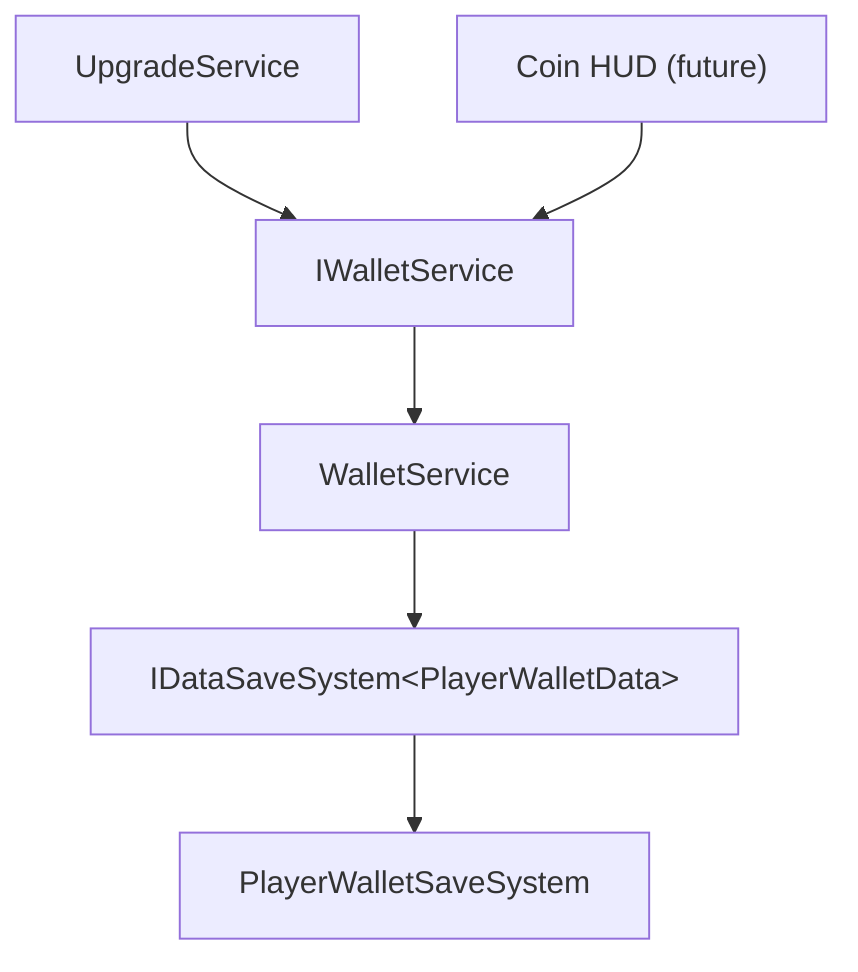

# Architecture Spine — Player Wallet

## Design Paradigm

Service-oriented, DI-injected durable singleton behind an interface, resolved through VContainer — the same shape as `UpgradeService`. The wallet owns live `PlayerWalletData`, persists every mutation through the stateless save system, and exposes a synchronous balance read with asynchronous, persisted mutations.

Namespaces: `IWalletService`, `WalletService`, `PlayerWalletData` → `MiraculousSurfers.Economy`; `PlayerWalletSaveSystem` → `MiraculousSurfers.Data`.

## Inherited Invariants

| Inherited | From | Binds here |
| --- | --- | --- |
| Stateless persistence (S1), `IResult<T>`, Newtonsoft, key-suffix versioning, VContainer | spec-save-system | `WalletService` owns the live instance; saves are `UniTask<IResult<T>>` |
| CLAUDE.md conventions | project | No comments, `var`, underscore privates, UniTask, `int` coins, code under `Assets/MiraculousSurfers/` |
| AD-6 — `IWalletService` is the sole wallet contract | player-upgrades spine | Upgrades depend only on this interface — **this spine supersedes its shape** (AD-2 below) |
| AD-7 — purchase integrity | player-upgrades spine | **This spine tightens it** from D1 optimistic to D2 rollback (AD-4 below) |

## Invariants & Rules

### AD-1 — Durable wallet service [ADOPTED]
- **Binds:** all coin state
- **Prevents:** a second holder of the balance; coins living only in memory
- **Rule:** `WalletService` (implements `IWalletService` + VContainer `IAsyncStartable`) is the single owner of live `PlayerWalletData`. It loads on `StartAsync` (fallback `CreateDefault`) and persists every mutation via `IDataSaveSystem<PlayerWalletData>`. It replaces `MockWalletService`.

### AD-2 — Async, persisted wallet contract (supersedes AD-6)
- **Binds:** every wallet caller (upgrades, future HUD)
- **Prevents:** treating a coin change as committed before it is persisted; callers reaching a concrete wallet
- **Rule:** `IWalletService` is `{ int Coins { get; }` (sync read); `UniTask<bool> TrySpend(int amount)` (atomic check-and-charge, persisted, `false` if insufficient); `UniTask AddCoins(int amount)` (credit, persisted); `event Action Changed` (fired after any balance change) `}`. `TrySpend`/`AddCoins` reject negative amounts. The real currency contract is now this; the player-upgrades spine's AD-6 sync shape is retired.

### AD-3 — Wallet data & save system
- **Binds:** persisted coin shape
- **Prevents:** a divergent coin store
- **Rule:** `PlayerWalletData { int Coins }`. `PlayerWalletSaveSystem : PlayerPrefsDataSaveSystem<PlayerWalletData>` (key `miraculoussurfers.player_wallet`, version `v1`), `CreateDefault` grants a starting balance (const, default `1000`, tunable), `IsValid` = `Coins >= 0`. Added via the save-system extensibility pattern (CAP-5) — no change to the save core.

### AD-4 — Refund-based purchase integrity, D2 (tightens AD-7)
- **Binds:** `UpgradeService.TryUpgrade`
- **Prevents:** a durable coin debit outliving a failed upgrade persist ("paid for nothing")
- **Rule:** `TryUpgrade` is `await TrySpend(price)` → bump index → `await SaveAsync(upgrades)`; on upgrade-save **failure**, `await AddCoins(price)` (refund) + revert the index, and return `Applied=false`. Either both sides persist or neither. The refund's own save is best-effort (logged if it also fails). This replaces the player-upgrades D1 optimistic rule now that coins are durable.

### Dependency direction



## Consistency Conventions

| Concern | Convention |
| --- | --- |
| Naming | `IWalletService` / `WalletService`; data `PlayerWalletData`; save `PlayerWalletSaveSystem`. |
| Data & formats | Persisted shape = `{ int Coins }`. Coins are `int`, always `>= 0`. Mutations reject negative amounts. |
| State & cross-cutting | One live owner (`WalletService`). Mutate-in-memory then persist (await). Async = UniTask; reads sync. Change notification = `IWalletService.Changed`. DI = VContainer singleton + `IAsyncStartable`, registered in `GameplayLifetimeScope`. |

## Stack

| Name | Version |
| --- | --- |
| Unity | 6000.6.0f1 |
| VContainer | 1.19.0 |
| UniTask | 2.5.11 |
| Newtonsoft Json (Unity) | 3.2.2 |

## Structural Seed

```text
Assets/MiraculousSurfers/Scripts/
  Economy/
    IWalletService.cs          # revised: async, persisted, AddCoins, Changed
    WalletService.cs           # durable, IAsyncStartable; owns PlayerWalletData
    PlayerWalletData.cs        # { int Coins }
    MockWalletService.cs       # REMOVED (superseded)
  Data/
    PlayerWalletSaveSystem.cs  # PlayerPrefsDataSaveSystem<PlayerWalletData>
  Gameplay/
    Upgrades/UpgradeService.cs         # TryUpgrade: await wallet ops + B2 refund
    LifetimeScopes/GameplayLifetimeScope.cs  # register WalletService (entry point) + PlayerWalletSaveSystem; drop Mock + _startingCoins
```

## Capability → Architecture Map

| Area | Lives in | Governed by |
| --- | --- | --- |
| Spend / add / balance | `WalletService` | AD-1, AD-2 |
| Durable coin storage | `PlayerWalletData` + `PlayerWalletSaveSystem` | AD-3 |
| Consistent purchase | `UpgradeService.TryUpgrade` | AD-4 |

## Deferred

- **Coin HUD UI** — seam is `IWalletService.Changed` + `Coins`. Build when the HUD exists.
- **Routing `Changed` through `GameplayEventBus`** — the user added a bus in parallel; the wallet keeps a direct C# event for now.
- **Multi-currency** — single `int` coins only; a currency type would reshape the contract.
- **Operational envelope** — N/A: editor/runtime-only prototype feature.
