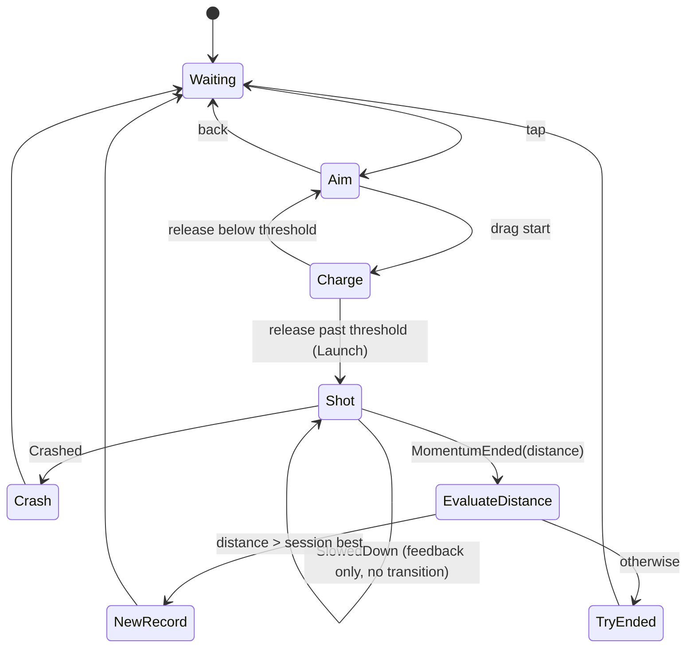

# Gameplay State Machine — Flow, Contract, and Component Map

Companion to `SPEC.md`. Holds the flow diagram, the state/transition table, the character event contract, and the mapping to the scaffolded components.

## Flow diagram

## State / transition table

| State | Role | Input (own action map) | Leaves to | Trigger |
|---|---|---|---|---|
| Waiting `[initial]` | Camera frames character, "Tap to begin" shows | tap | Aim | tap |
| Aim | Behind-the-character view; entering runs the orbital sweep | back, drag-start | Waiting / Charge | back / drag start |
| Charge | Reads drag in its own gated `Update`; computes power + direction | pointer position, release | Aim / Shot | release below / past threshold |
| Shot | Subscribes to character, then launches; no return to pre-shot states | none | Crash / EvaluateDistance | Crashed / MomentumEnded |
| EvaluateDistance | Visual-less decision node; reads `TraveledDistance`, compares to `ScoreManager` | none | NewRecord / TryEnded | distance vs best |
| NewRecord | Happy anim + record mark on level map | none | Waiting | presentation complete |
| TryEnded | Ordinary end (future: rewards sub-flow here) | none | Waiting | immediate / after sub-flow |
| Crash | Death anim | none | Waiting | anim complete |

## Character event contract

The character is a self-driving actor. The machine commands it and reacts to its events.

| Member | Kind | Meaning | Machine reaction |
|---|---|---|---|
| `Launch(float power, Vector3 direction)` | command | Start a run; resets `TraveledDistance` | called by Shot on enter |
| `TraveledDistance` | state (per-run) | Distance this run; resets on `Launch` | read by EvaluateDistance |
| `SlowedDown` | event | Hit a slowing obstacle | feedback only — no transition |
| `Crashed` | event | Hit a stopping obstacle | Shot → Crash |
| `MomentumEnded(float distance)` | event | Momentum ran out | Shot → EvaluateDistance |

## Recurring pattern

Every state reduces to: **configure presentation on enter → react to one event → `GoTo`**. The same command→subscribe→react shape recurs across state↔character, state↔input-map, and (future) state↔sub-machine. A state subscribes on enter and must unsubscribe on exit (enforced by the base class).

## Component map (scaffolded implementation)

Namespace `MiraculousSurfers.Gameplay`, under `Assets/MiraculusSurfers/Scripts/Gameplay/`.

| Concern | Type | Location |
|---|---|---|
| Base state (async lifecycle, input-map handling, unsubscribe hygiene) | `GameplayState` | `StateMachine/` |
| Orchestrator (holds Current, `GoTo`, cancels in-flight transitions) | `GameplayStateMachine` | `StateMachine/` |
| States | `WaitingState`, `AimState`, `ChargeState`, `ShotState`, `EvaluateDistanceState`, `NewRecordState`, `TryEndedState`, `CrashState` | `StateMachine/States/` |
| Shared actor (contract stub) | `Character` | `Gameplay/` |
| Session best | `ScoreManager` | `Gameplay/` |
| Orbital camera wrapper (`AnimateToAsync`) | `OrbitalCameraRig` | `Gameplay/` |

Dependencies: Cinemachine 6.6.0, UniTask 2.5.11, Input System 1.20.0, Unity 6000.6.0f1 (URP).
