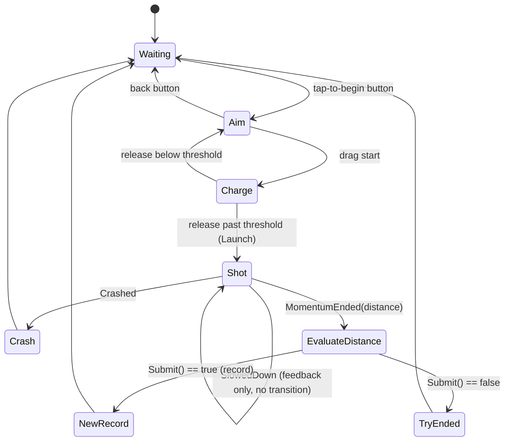

# Gameplay State Machine — Flow, Contract, and Component Map

Companion to `SPEC.md`. Holds the flow diagram, the state/transition table, the character event contract, the UI/input model, and the mapping to the implemented components.

## Flow diagram

## State / transition table

| State | Role | Own input (how) | Leaves to | Trigger |
|---|---|---|---|---|
| Waiting `[initial]` | Prioritizes camera rig, animates to waiting preset, fades in home screen | `HomeScreenUiView.TapToPlay` (UI Button event) | Aim | tap-to-begin |
| Aim | Sweeps camera to behind preset, fades in aim screen | `AimScreenUiView.Back` (UI Button event) + `"Aim"` action map `DragStart` (InputAction) | Waiting / Charge | back / drag start |
| Charge | Enables pointer + release `InputActionReference`s; reads drag in gated `Update`; computes power + direction | pointer position (read), release (performed) | Aim / Shot | release below / past `_fireThreshold` |
| Shot | Subscribes to character, then `Launch`es; no return to pre-shot states | none | Crash / EvaluateDistance | Crashed / MomentumEnded |
| EvaluateDistance | Visual-less decision node; `ScoreManager.Submit(TraveledDistance)` | none | NewRecord / TryEnded | Submit() true / false |
| NewRecord | `Happy` animator trigger + fixed delay (level-map record mark not yet built) | none | Waiting | delay complete |
| TryEnded | Immediate passthrough (future: rewards sub-flow here) | none | Waiting | immediate / after sub-flow |
| Crash | `Die` animator trigger + fixed delay | none | Waiting | delay complete |

## Character event contract

The character is a self-driving actor (`MiraculousSurfers.Gameplay.Characters.Character`). The machine commands it and reacts to its events.

| Member | Kind | Meaning | Machine reaction |
|---|---|---|---|
| `Launch(float power, Vector3 direction)` | command | Start a run; resets `TraveledDistance` to 0 | called by Shot on enter |
| `TraveledDistance` | state (per-run) | Distance this run; resets on `Launch` | read by EvaluateDistance |
| `SlowedDown` | event | Hit a slowing obstacle | feedback only — no transition |
| `Crashed` | event | Hit a stopping obstacle | Shot → Crash |
| `MomentumEnded(float distance)` | event | Momentum ran out | Shot → EvaluateDistance |

The base `Character` is a stub; a concrete subclass drives movement/animation and calls the protected `RaiseSlowedDown` / `RaiseCrashed` / `RaiseMomentumEnded` helpers. **The concrete flight movement model (kinematic auto-run, steering, fuel-based momentum, bounds, distance, obstacles) is specced in `spec-character-running` (`../spec-character-running/SPEC.md`, adopted companion).**

## Flight camera & smooth reset

- **Per-phase Cinemachine cameras, blended by `CinemachineBrain`.** Wait/Aim use the shared orbital-follow rig (`OrbitalCameraRig`, orbit presets). The flight phase `Prioritize()`s an **additional dedicated chase camera** (Third Person Follow); the brain blends into it automatically. This matches the existing `Activate()` → `Prioritize()` pattern.
- **Reset-to-Waiting is hidden behind the `UiScreenView` fade.** Sequence: terminal state fades out → re-prioritize the Waiting camera + command the character's `CharacterController`-safe reset to spawn (`cc.enabled=false` → set transform → `cc.enabled=true`; zero fuel/distance/steer-target) → fade in with Waiting framing the origin. The teleport happens behind black, so there is no cross-level camera swoop.

## Test harness — stub ChargeState

Until the real drag-based Charge exists, a **stub `ChargeState`** stands in so the flight path can be built and tested:

- Editor-exposed `power` and `direction` fields.
- In Aim, a **tap that is not the Back button** enters it; it `Configure`s `ShotState` with the serialized values and transitions — exercising the real `Aim → Charge → Shot → flight` path with the drag math faked.
- An instance of CAP-7 extensibility: a swapped state variant changes the flow with zero code change to other states.

## UI / input model

Input is **hybrid and decentralized per state** — no single global input owner:

- **UI Buttons → C# events.** `UiScreenView` is the base presentation component: it fades a `CanvasGroup` in/out via UniTask (`ShowAsync` / `HideAsync`), gating `interactable` / `blocksRaycasts` and toggling child elements around the fade. Subclasses add a button and an event: `HomeScreenUiView.TapToPlay`, `AimScreenUiView.Back`. The owning state subscribes to the event on enter and unsubscribes on exit.
- **Gestures → Input System.** Aim enables a named Action Map (`"Aim"`) and listens to its `DragStart` action; Charge enables individual `InputActionReference`s (pointer position + release) and disables them on exit. States enable only what they need.

Each state therefore awaits its presentation (camera sweep, UI fade) before input is live, and tears down both input and UI on exit.

## Recurring pattern

Every state reduces to: **configure presentation on enter → react to one event → `GoTo`**. The same command→subscribe→react shape recurs across state↔character, state↔UI-view, state↔input-action, and (future) state↔sub-machine. A state subscribes on enter and must unsubscribe on exit — enforced by the base `GameplayState` (which also unsubscribes on `OnDisable` and before `OnExitAsync`).

## Component map (current implementation)

Root namespace `MiraculousSurfers.Gameplay`, under `Assets/MiraculousSurfers/Scripts/Gameplay/`.

| Concern | Type | Namespace | Location |
|---|---|---|---|
| Base state (async lifecycle, unsubscribe hygiene) | `GameplayState` | `.Gameplay` | `StateMachine/` |
| Orchestrator (holds Current, `GoTo`, cancels in-flight transitions, warns on `GoTo(null)`) | `GameplayStateMachine` | `.Gameplay` | `StateMachine/` |
| States | `WaitingState`, `AimState`, `ChargeState`, `ShotState`, `EvaluateDistanceState`, `NewRecordState`, `TryEndedState`, `CrashState` | `.Gameplay` | `StateMachine/States/` |
| UI screen base (CanvasGroup fade show/hide) | `UiScreenView` | `.Gameplay.UI` | `UI/` |
| UI screens | `HomeScreenUiView` (TapToPlay), `AimScreenUiView` (Back) | `.Gameplay.UI` | `UI/` |
| Shared actor (contract stub) | `Character` | `.Gameplay.Characters` | `Characters/` |
| Session best (`Best`, `Submit`) | `ScoreManager` | `.Gameplay.Score` | `Score/` |
| Orbital camera wrapper (`Activate`, `SetImmediate`, `AnimateToAsync`) | `OrbitalCameraRig` | `.Gameplay` | `Camera/` |
| Serializable orbit axis preset (`Horizontal`, `Vertical`, `Radius`) | `OrbitPreset` (struct) | `.Gameplay` | `Camera/` |

Dependencies: Cinemachine 6.6.0, UniTask 2.5.11, Input System 1.20.0, Unity 6000.6.0f1 (URP).
