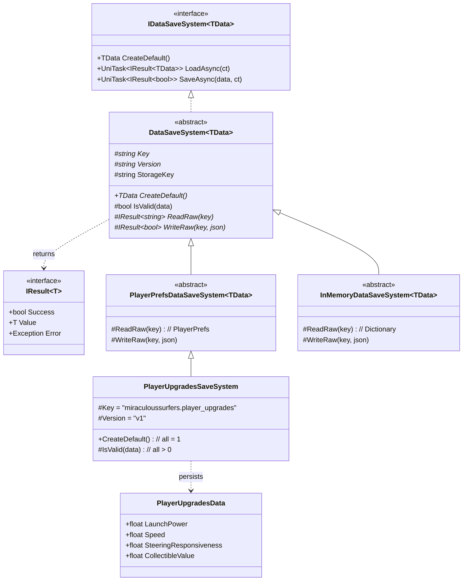
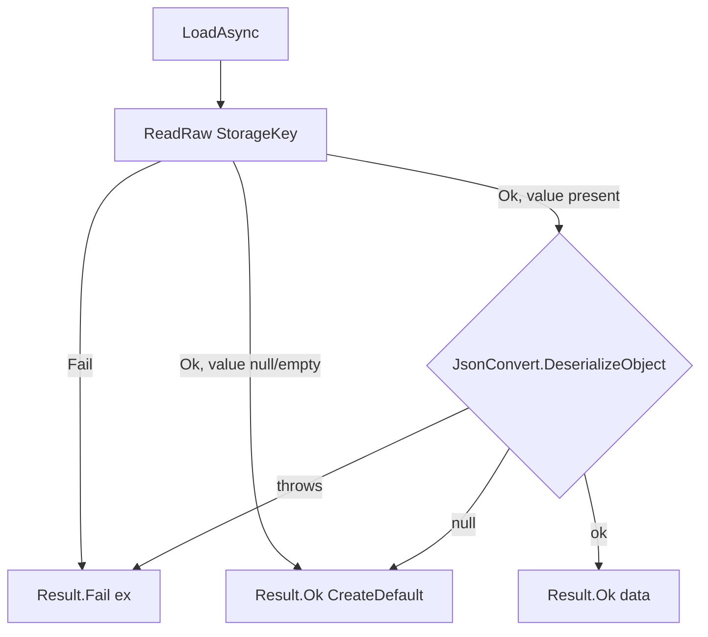

# Save System — Architecture Diagrams

Companion to `SPEC.md`. The whole design is one idea — a single `ReadRaw`/`WriteRaw` seam — wearing many hats.

## Class hierarchy

- `*` marks `abstract` members a concrete/backend subclass must fill.
- The base owns **all** version-key building, Newtonsoft (de)serialize, and `Result` wrapping. Backends fill only `ReadRaw`/`WriteRaw`. A concrete type fills only `Key`, `Version`, `CreateDefault`, and (optionally) `IsValid`.

## Load flow (where the seam decides behaviour)

- **Absent key → `Ok(default)`** (CAP-4, first-run safe).
- **Corrupt/throw → `Fail(ex)`** (CAP-2); caller falls back to `CreateDefault()` (F2a default-and-overwrite).
- `StorageKey = $"{Key}.{Version}"` — bump `Version` and the read targets a new key (CAP-3, data abandoned, no migration).

## The one seam, many hats

Every "flexible/extendable" property is latent in the single `ReadRaw`/`WriteRaw` hole:

- **New data type** = a new concrete subclass (CAP-5).
- **Backend swap** = a new abstract base over the same hole (CAP-6).
- **Test mock** = the in-memory base, ~2 lines, sharing the real serialize/version path (CAP-6).
- **Deferred trio** — injected `IStorageBackend`, backup-copy corrupt-recovery (F2c), file/cloud backend — all hang off this same seam, so none needs a redesign later.
